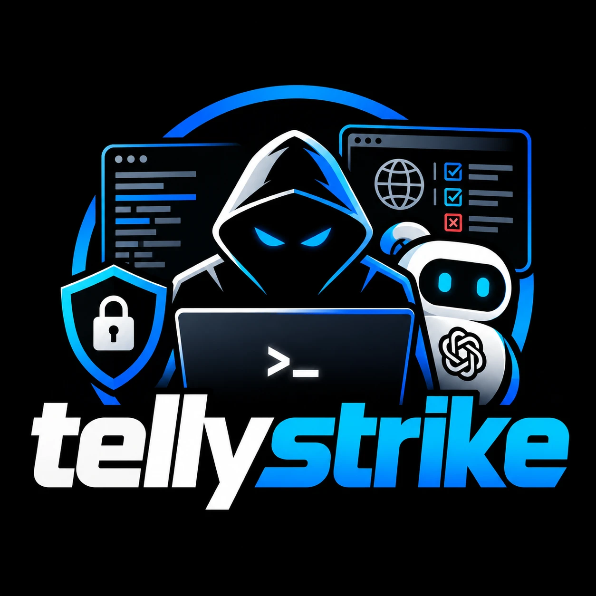

<p align="center">
  
</p>

<p align="center">
  <b>Point it at an app you own. It runs every security check the pros run, then hands you one plain report.</b>
</p>

Your code. Your dependencies. Your MCP tools. Your agent skill files. Your live site. Even your
app's AI, which it tries to trick into ignoring its own instructions so you find out before
someone else does.

Free. No account, no signup, clone it and go. The only key you ever need is your own OpenRouter key,
and only for the AI checks.

```bash
cp .env.example .env            # add your OpenRouter key
./run-pipeline.sh ./my-app                                   # code + dependency + MCP checks
./run-pipeline.sh ./my-app http://127.0.0.1:3000 --agentgg   # + AI that confirms access-control bugs
./run-pipeline.sh ./my-app http://127.0.0.1:3000 --pyrit http://127.0.0.1:3000/api/ai   # + AI red-team
```

You get one report in `runs/<name>-<timestamp>/REPORT.md`.

## Why this exists

I ran this on my own live apps. On one of them it found a **cross-tenant IDOR** — any logged-in user
could read, edit, and **delete** another tenant's data by guessing an ID — that **three automated
scanners missed.** Pattern-matching SAST is blind to authorization; only the agentic pass and the
live exploit caught it. That gap is the whole point: this pipeline chains the layers so the bug class
each tool misses gets caught by the next one.

The **AI red-team** phases are the layer none of the code/network scanners can do: they test
whether your app's *AI* obeys a planted instruction. **PyRIT** (6c) fires injection seeds at your
AI endpoint N times each and scores whether a harmless marker leaked into the reply (= the
injection beat your system prompt). **garak** (6d, NVIDIA) hits the same endpoint with a much
larger probe library — jailbreaks, indirect injection, encoding attacks, data leakage — so run
both to cover more ground. Point them at your AI route, not the app root.

## The phases

| # | Phase | Tool | Finds | Key? |
|---|-------|------|-------|------|
| 1 | Recon | built-in | langs, deps, is-it-an-MCP-server, live target | — |
| 2 | Deps (SCA) | OSV-Scanner | known CVEs in dependencies | **no account** |
| 3 | SAST | Semgrep (OSS) | data-flow bugs: SSRF, injection | **no account** |
| 4 | MCP audit | mcp-scanner | tool poisoning / prompt injection (MCP servers) | LLM analyzer = key |
| 4b | Skills audit | built-in | poisoned `SKILL.md` / agent files: hidden instructions, exfil | **no account** |
| 5 | Agentic SAST | AgentGG | confirms bugs incl. **authz / IDOR** that SAST misses | **OpenRouter** |
| 6 | Live PoC | your exploit script | proves real impact on the running box | — |
| 6b | Attack | nuclei / OWASP ZAP | live scan of the running box (nuclei needs no server) | **no account** |
| 6c | AI red-team | PyRIT | injection seeds at an AI endpoint, scored over N runs | optional (smart layer) |
| 6d | AI red-team | garak (NVIDIA) | big probe library (jailbreak, injection, leakage) at an AI endpoint | optional |
| 7 | Report | built-in | one REPORT.md of everything | — |

Install the third-party tools per [INSTALL.md](INSTALL.md). This repo is the **orchestrator + the
PyRIT driver** — it calls tools you install yourself, so each keeps its own license.

## The only key you need

The core phases need **no account and no key**: OSV-Scanner (deps) and Semgrep (SAST) are
account-free by design, and so are the ZAP/nuclei attack and the PyRIT marker test.

The only keys are optional and yours — one `OPENROUTER_API_KEY` in `.env` unlocks the AI phases:
- **AgentGG** — drive it via OpenRouter (not the Anthropic path).
- **PyRIT** — the marker-leak scoring is keyless; a key only powers PyRIT's LLM converters/scorers.
- **mcp-scanner** — yara/static analyzers are keyless; the LLM analyzer uses the key.

## Rules of the road

**Authorized / own targets only.** Point the code phases at code you control and the live/attack
phases at a box you own or have written authorization to test. The AI red-team uses a harmless marker
(not real abuse text) so the test is about *control*, not content. Running the attack phase against
something you don't own is illegal and not supported.

## License

MIT — the engine is free and open. (A hosted dashboard / team platform, if one ships, is a separate
product.) See [LICENSE](LICENSE).
